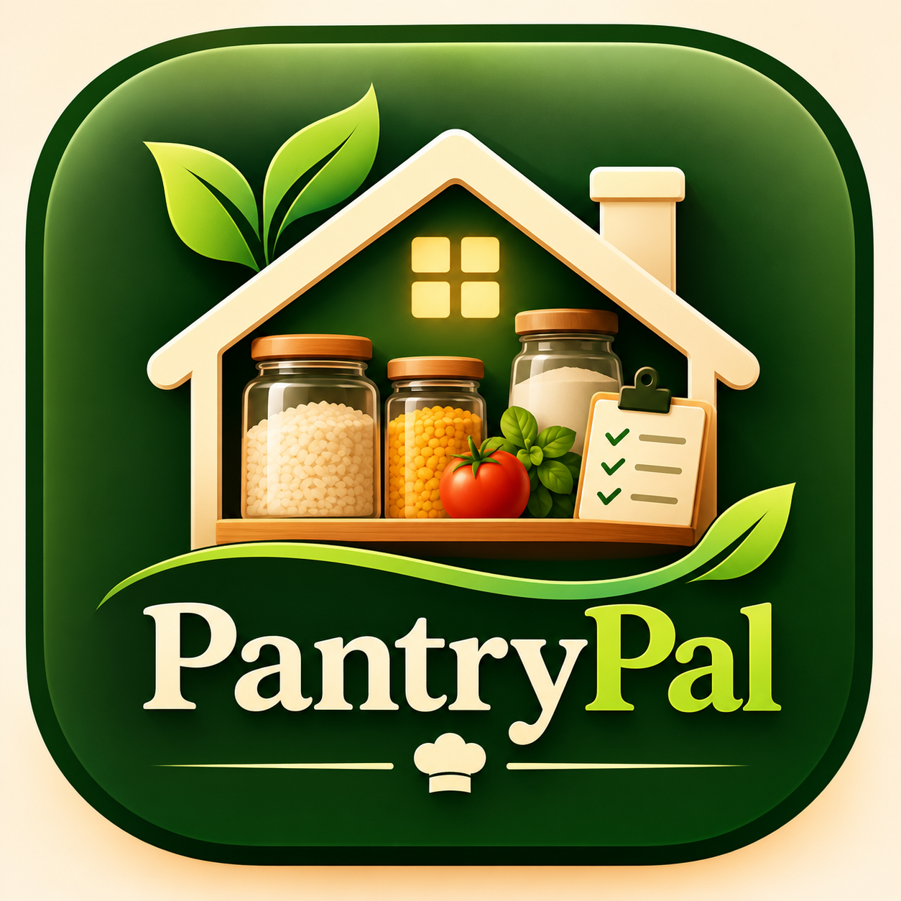

# 🌿 PantryPal – Smart Pantry Management System

<p align="center">
  
</p>

<h3 align="center">Your Kitchen, Intelligently Organised.</h3>

<p align="center">
  A Java-based application designed to simplify pantry management, monitor food expiry dates, organise shopping lists, and suggest recipes using available ingredients.
</p>

---

## 📌 About the Project

**PantryPal** is a Smart Pantry Management System developed using Java. It helps users manage kitchen inventory, monitor stock levels, track expiry dates, and organise grocery requirements through an interactive graphical interface.

The application provides two interfaces:

* **JavaFX:** A modern dashboard with a Dark Forest Green theme.
* **Java Swing:** An alternative interface for pantry and shopping list management.

Both interfaces use a shared backend and file-based storage.

## ✨ Key Features

* **Dashboard:** Overview of pantry inventory and stock information.
* **Pantry Management:** Add, update, delete, and search pantry items.
* **Stock Monitoring:** Identifies low-stock and out-of-stock items.
* **Expiry Tracking:** Highlights expired and soon-to-expire ingredients.
* **Shopping List:** Add, remove, and mark items as purchased.
* **Recipe Suggestions:** Suggests predefined recipes based on available ingredients.
* **Data Persistence:** Saves pantry and shopping list information using file handling.

## 🛠️ Technologies Used

| Technology              | Purpose                         |
| ----------------------- | ------------------------------- |
| Java (JDK 26)           | Core application development    |
| JavaFX 27.0.1           | Primary graphical interface     |
| Java Swing              | Alternative graphical interface |
| FXML                    | JavaFX layout design            |
| CSS                     | Interface styling               |
| Java File I/O           | Data storage and retrieval      |
| ArrayList & Collections | Data management                 |
| LocalDate               | Expiry date handling            |
| Git & GitHub            | Version control                 |
| VS Code                 | Development environment         |

## 🏗️ System Architecture

```text
             PANTRYPAL
                 |
        -------------------
        |                 |
      JavaFX            Swing
        |                 |
        -------------------
                 |
           Shared Backend
                 |
     ---------------------------
     |             |           |
PantryManager  ShoppingList  RecipeSuggestion
               Manager      Service
     |             |           |
     ---------------------------
                 |
             FileManager
                 |
       ---------------------
       |                   |
   pantry.txt       shopping_list.txt
```

## 📂 Project Structure

```text
PantryPal/
├── Main.java
├── PantryItem.java
├── ShoppingListItem.java
├── PantryManager.java
├── ShoppingListManager.java
├── RecipeSuggestionService.java
├── FileManager.java
├── SwingMain.java
├── JavaFXMain.java
├── DashboardController.java
├── dashboard.fxml
├── styles.css
├── pantrypal-logo.png
├── pantry.txt
├── shopping_list.txt
└── README.md
```

## ⚙️ Getting Started

### Prerequisites

* Java Development Kit (JDK)
* JavaFX SDK 27.0.1
* VS Code or IntelliJ IDEA

### Clone the Repository

```bash
git clone https://github.com/sathviktrd76/PantryPal.git
cd PantryPal
```

### Run the JavaFX Application

Compile:

```bash
javac --module-path "PATH_TO_JAVAFX_LIB" --add-modules javafx.controls,javafx.fxml *.java
```

Run:

```bash
java --module-path "PATH_TO_JAVAFX_LIB" --add-modules javafx.controls,javafx.fxml JavaFXMain
```

Replace `PATH_TO_JAVAFX_LIB` with the location of your JavaFX SDK's `lib` directory.

To launch the Swing interface:

```bash
java SwingMain
```

## 🧪 Testing

The application has been tested for:

* Pantry item addition, updating, deletion, and searching.
* Stock-level and expiry-status identification.
* Shopping list management and purchase tracking.
* Recipe suggestions based on available ingredients.
* Data persistence across application sessions.
* Sequential data access through both interfaces.

## 🔮 Future Enhancements

* Database integration.
* Barcode scanning.
* Expiry notifications.
* Advanced recipe recommendations.
* Cloud-based data synchronisation.
* Integration with online grocery platforms.

---

## 👨‍💻 Project Information

**Project:** PantryPal – Smart Pantry Management System
**Domain:** Java Application Development
**Repository:** [github.com/sathviktrd76/PantryPal](https://github.com/sathviktrd76/PantryPal)

---


## 👨‍💻 Made By

**Sathvik Talabathula**

B.Tech – Computer Science and Engineering (AI & ML) | 
CMR University

**GitHub:** [@sathviktrd76](https://github.com/sathviktrd76)

---

<p align="center">
  <strong>PantryPal – Your Kitchen, Intelligently Organised. 🌿</strong>
</p>
